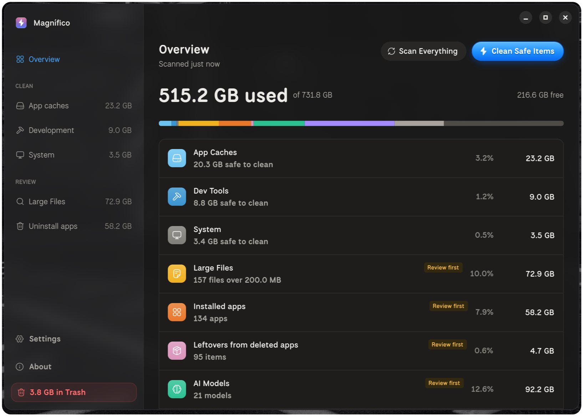

# Magnífico

Magnífico is a native Linux application for safely reclaiming disk space. Built with Rust, GTK 4, and libadwaita, it provides a clean GNOME-style interface for reviewing and removing browser data, application caches, temporary files, logs, and other unnecessary data.

Made for Linux with the GNOME desktop (developed on Fedora and Arch Linux).



## Features

- **Overview** shows disk usage, category sizes and the space already in Trash. Scan Everything refreshes the readings; Clean Safe Items opens the cleanup selection.
- **Clean** groups regenerable data into App Caches, Dev Tools and System, with safety explanations and filters for items that need review.
- **Review** provides Large Files with search and duplicate filters, App Uninstaller for installed apps and leftover data, and lists of downloaded AI models and games.
- Review the selected items and their sizes in the confirmation dialog before cleaning. Files go to Trash according to your deletion settings; regenerable caches can be deleted directly. Open or empty Trash from the sidebar.
- Configure scheduled cleanup, login startup, the system tray, custom directories, log retention and appearance in Settings. Review cleanup reports in About.

The interface and workflow are adapted from [Purge](https://github.com/jithin-sabu/purge-app) (MIT, © 2026 Jithin Sabu). See [third-party licenses](THIRD_PARTY_LICENSES.md).

## Safety

Magnífico is designed to make cleanup operations transparent and predictable:

- Manual cleanup can require confirmation before deletion.
- Critical system paths are protected by a built-in denylist.
- Operation limits can prevent unexpectedly large cleanups.
- Active browsers are detected to reduce the risk of database corruption.
- System journal cleanup requires administrator approval.
- Cleanup logs are kept in memory and are not written permanently without user consent.

Always review the selected cleanup options before removing data you may want to keep, especially browser cookies and session data.

## Install

Download the latest `.deb`, `.rpm` or tarball from the [Releases](https://github.com/wfpaisa/Magnifico/releases) page, or let the script pick the right one for your distribution:

```bash
curl -fsSL https://raw.githubusercontent.com/wfpaisa/Magnifico/main/scripts/install.sh | bash
```

### Arch Linux

There is no AUR package yet. Build and install the pacman package from a checkout (it installs under `/usr`, so pacman tracks it):

```bash
git clone https://github.com/wfpaisa/Magnifico.git
cd Magnifico/packaging/arch
makepkg -si
```

Remove it with pacman:

```bash
sudo pacman -R magnifico
```

If you ran the `curl … | bash` script on Arch, it installed the tarball files under `/usr/local` instead (not tracked by pacman); remove those with the tarball command below. For a user-only install, see `./scripts/install-local.sh` under Packaging.

### Uninstall

The script installs a system-wide package (or, on other distributions, files under `/usr/local`). Remove it the same way it was installed. Your settings and logs are kept.

| Installed with | Uninstall |
| --- | --- |
| `.deb` (Debian, Ubuntu) | `sudo apt remove magnifico` |
| `.rpm` (Fedora) | `sudo dnf remove magnifico` |
| `.rpm` (openSUSE) | `sudo zypper remove magnifico` |
| Tarball (Arch and others without apt, dnf or zypper) | the command below |

```bash
sudo rm -f /usr/local/bin/magnifico \
  /usr/local/share/applications/io.github.wfpaisa.Magnifico.desktop \
  /usr/local/share/metainfo/io.github.wfpaisa.Magnifico.metainfo.xml \
  /usr/local/share/icons/hicolor/scalable/apps/io.github.wfpaisa.Magnifico.svg \
  /usr/local/share/icons/hicolor/symbolic/apps/io.github.wfpaisa.Magnifico-symbolic.svg
```

If you installed it for your user only with `./scripts/install-local.sh`, use `./scripts/install-local.sh --uninstall` instead.

## Requirements

- Linux
- Rust stable and Cargo
- GTK 4.8 or newer
- libadwaita 1.5 or newer
- GLib development tools and `pkg-config`

The exact development package names depend on your Linux distribution.

## Build from Source

```bash
git clone https://github.com/wfpaisa/Magnifico.git
cd Magnifico
cargo build --release --locked
```

Run the optimized build:

```bash
./target/release/magnifico
```

For development:

```bash
cargo run --locked
```

## Packaging

The repository includes helper scripts for creating common Linux packages:

```bash
./scripts/package-rpm.sh
./scripts/package-deb.sh
./scripts/package-appimage.sh
```

On Arch Linux, build and install the package from the repository checkout:

```bash
cd packaging/arch
makepkg -si
```

To install for the current user only (no root), run `./scripts/install-local.sh`; use `--uninstall` to remove it.

Generated packages are placed under the `dist/` directory. The RPM script always rebuilds the current release binary and writes the RPM directly to `dist/rpm/`, regardless of the directory from which the script is invoked. The installed package and command name is `magnifico`.

### Build and install locally

`./scripts/install-local.sh` builds the release binary and installs the binary, desktop entry, metainfo and icons under `~/.local`. Close and reopen Magnífico afterwards so the new binary is used.

### Publishing a release

`./scripts/release.sh` runs the checks, builds the RPM, DEB, AppImage and tarball, writes `SHA256SUMS` and uploads everything to a GitHub release. It chooses the version for you:

| Situation | What it does |
| --- | --- |
| `v<version>` from `Cargo.toml` has no tag yet | Releases the current version as is. |
| The tag exists and there are new commits or uncommitted changes | Recommends a patch bump (e.g. 1.0.1 → 1.0.2) and asks first. |
| The tag exists and nothing changed | Keeps the version and only asks before replacing the assets. |
| The tag is already on `origin` with different code | Refuses; choose a new version or pass `--replace-assets`. |

A version change updates `Cargo.toml`, `Cargo.lock`, `packaging/arch/PKGBUILD` and the AppStream release list, then creates a `Release X.Y.Z` commit. Pending changes are only included in that commit (`git add -A`) after you confirm.

```bash
./scripts/release.sh --dry-run             # show the diagnosis and proposed version, change nothing
./scripts/release.sh --bump minor          # patch (default), minor, major or none
./scripts/release.sh --version 2.0.0       # exact version
./scripts/release.sh --no-upload           # build everything into dist/release only
./scripts/release.sh --yes                 # accept recommendations and prompts
./scripts/release.sh --skip-checks         # skip fmt, clippy and tests
./scripts/release.sh --notes FILE          # release notes (default: RELEASE_NOTES.md or GitHub-generated)
```

Published tags are never rewritten.

## Contributing

Contributions, bug reports, and feature suggestions are welcome.

1. Fork the repository.
2. Create a branch for your change.
3. Run the checks before submitting:

   ```bash
   cargo fmt --check
   cargo test --locked
   cargo clippy --all-targets --locked -- -D warnings
   ```

4. Open a pull request with a clear description of the change.

Please use [GitHub Issues](https://github.com/wfpaisa/Magnifico/issues) to report bugs or suggest improvements.

## License

Magnífico is released under the [MIT License](LICENSE).
